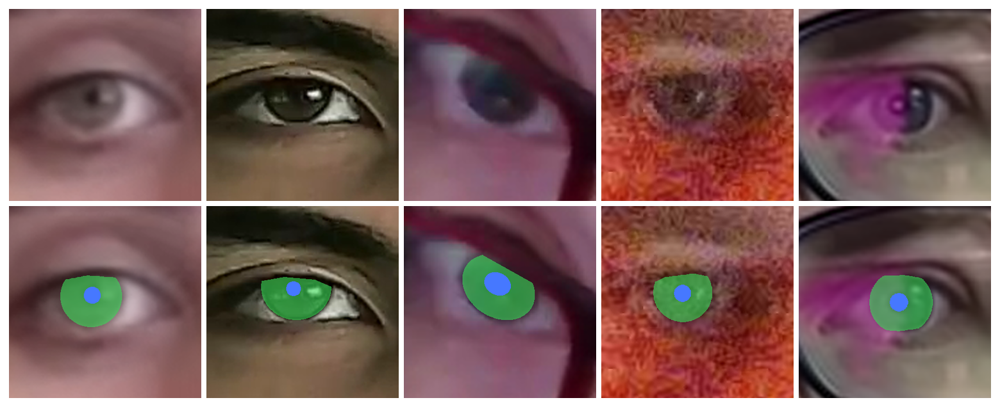
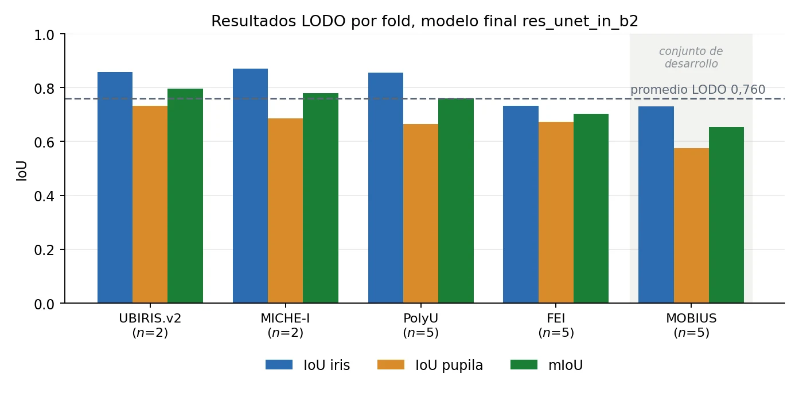
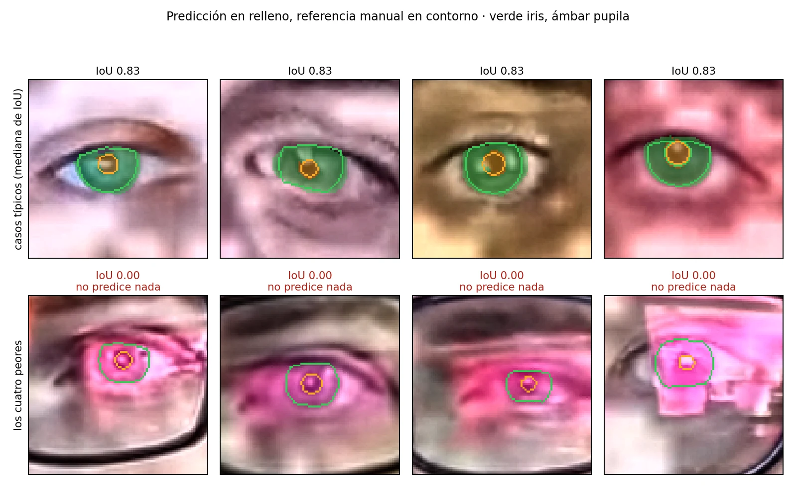
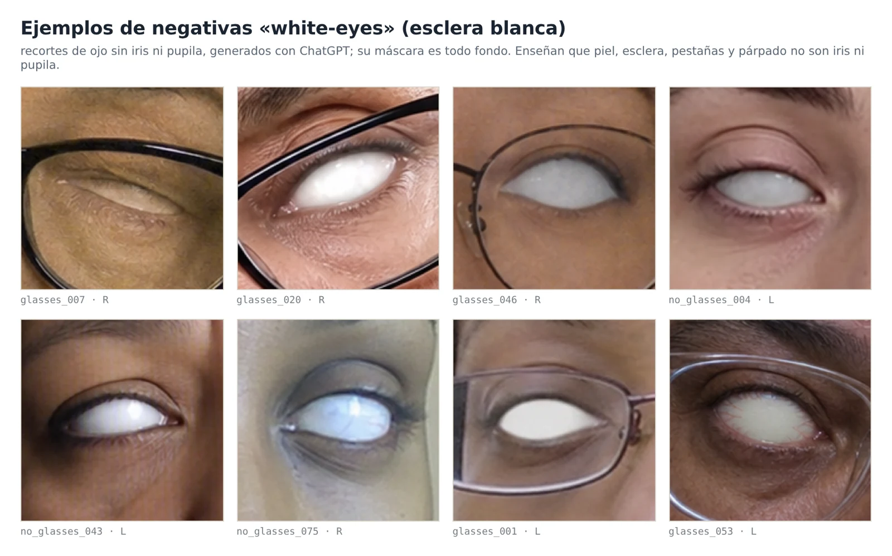
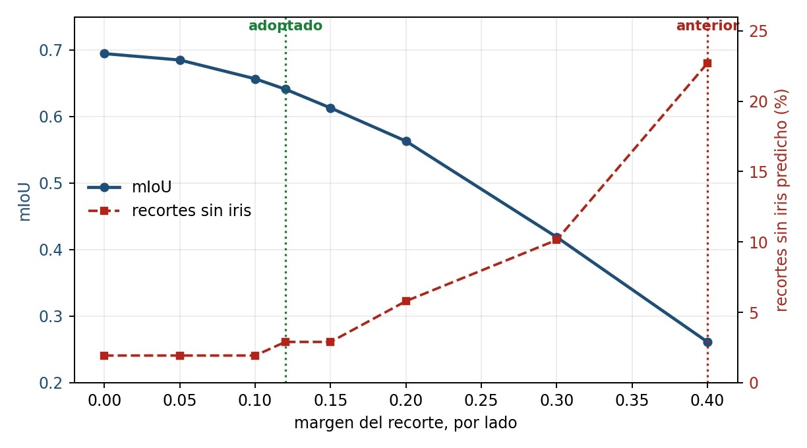

[Tesis (PDF)](https://github.com/lucasikruger/vis-iris-pupil-segmentation/releases/download/v1.0/tesis.pdf) · [Dataset (acceso a pedido)](https://huggingface.co/datasets/lucasikruger/vis-iris-pupil-segmentation-data) · [Demo](https://huggingface.co/spaces/lucasikruger/vis-iris-pupil-segmentation) · [Cita](#cita-y-licencias)

# Segmentación ocular con cámaras web

El aporte principal de esta tesis es la preparación y anotación de datos de iris y
pupila en luz visible, con un formato común para entrenar y evaluar segmentadores.
El repositorio reúne los preparadores, las particiones y una ResU-Net entrenada con
esos datos, junto con una demo web para probarla en recortes oculares y cámaras web.



Arriba, cinco ojos del conjunto propio de webcam. Abajo, los mismos recortes con
sus **anotaciones de referencia**, iris en verde y pupila en azul. No son
predicciones del modelo. [Script y procedencia de la figura](docs/img/README.md).

## Conjunto de datos

Hay pocas anotaciones densas de iris y pupila en luz visible que puedan usarse
juntas. Las bases difieren en encuadre, resolución y etiquetas. Algunas anotan
solo el iris o describen sus bordes con elipses que completan zonas tapadas.
Construimos un formato de tres clases, fondo, iris y pupila, que conserva las
oclusiones: la máscara marca la región visible, sin completar el iris detrás
del párpado.

El pool reúne 16.898 recortes. El [catálogo](data/DATA.md) detalla las fuentes,
permisos, cantidades y transformaciones. El trabajo propio incluye:

- PolyU aporta 5.749 máscaras proyectadas de NIR a VIS, CASIA aporta 2.479 máscaras
  obtenidas con un proceso híbrido y FEI aporta 210 máscaras manuales.
- UBIRIS: anotación y corrección del canal pupilar. MICHE: polígonos palpebrales
  y coordenadas propias. El iris de UBIRIS y el GT manual de MICHE pertenecen a
  terceros y no se redistribuyen.
- White-eyes: 300 recortes negativos para entrenamiento y 38 para prueba, de
  rostros generados sin fotografías de base, con máscaras de fondo.
- Webcam propia: 218 recortes de 31 personas que dieron su consentimiento,
  207 con máscaras manuales y 11 descartes. Se reunió después de elegir la
  configuración y se reserva para evaluación. No se distribuyen las caras completas.

MOBIUS aporta el conjunto de desarrollo. TEyeD conserva sus etiquetas nativas.
No se presenta como anotación propia. El pool también incluye 960 negativas de
ojos cerrados cuya selección se conserva mediante huellas de píxeles.

### Acceso al paquete

El [dataset de Hugging Face](https://huggingface.co/datasets/lucasikruger/vis-iris-pupil-segmentation-data)
tiene **acceso a pedido, con aprobación manual**. Completá en esa página el
formulario con nombre, institución y uso previsto, y aceptá el uso no comercial
y no identificar a las personas. Después de recibir la aprobación, instalá las
[dependencias](#instalación) e iniciá sesión con la misma cuenta:

```sh
hf auth login
python scripts/tools/download_dataset.py --output dataset-package
```

El token necesita permiso de lectura del dataset. Iniciar sesión no reemplaza la
aprobación. El script explica los pasos si falta acceso. La opción `--revision <commit>`
permite fijar la versión descargada. `dataset-package/` queda fuera de Git.

El paquete contiene recortes propios, imágenes generadas, máscaras y coordenadas
propias. Las imágenes de bases externas y sus etiquetas nativas se obtienen de
sus titulares, bajo sus condiciones. El acceso al paquete no concede permisos
sobre esas bases.

### Reconstrucción

[partitions.csv](data/partitions.csv) fija la selección y las particiones.
Las cajas en `annotations/` permiten repetir los recortes sin volver a detectar
los ojos. Los scripts `prepare_*.py` leen esas anotaciones y las fuentes obtenidas
por separado. Los comandos por fuente están en [DATA.md](data/DATA.md#comandos).
Por ejemplo, con el paquete propio descargado:

```sh
python data/prepare/prepare_white_eyes.py --raw dataset-package
python data/prepare/prepare_webcam.py --raw dataset-package
python data/prepare/check_dataset.py --root data/mobius_format
```

Los preparadores contrastan sus salidas con las huellas conservadas del pool.
La reconstrucción completa desde las distribuciones originales de MICHE y TEyeD
no está validada. En CASIA, las cajas NIR coinciden, pero la traducción pix2pix en
CPU difiere del JPEG archivado. El catálogo separa lo comprobado de esos límites.

## Modelo y evaluación

ResU-Net con InstanceNorm (`res_unet_in_b2`, 323.981 parámetros), entrada RGB 96×96,
CLAHE + gamma y salida de tres clases. MediaPipe localiza los ojos con un margen
del 12 % por lado. La máscara permite obtener el centro pupilar. El proyecto no
incluye calibración ni estimación de mirada.

### Resultados

| Resultado de la tesis | Valor |
|---|---:|
| LODO, promedio de cuatro fuentes sin selección de configuración | 0,760 mIoU |
| UBIRIS / MICHE / PolyU / FEI | 0,796 / 0,779 / 0,761 / 0,703 |
| Webcam propia: 207 ojos, 31 personas | 0,641 mIoU |
| Webcam: IoU iris / pupila | 0,707 / 0,575 |
| Webcam: centro del disco de iris, píxeles de captura | 1,01 |
| Comparación pareada de centro pupilar, red / MediaPipe | 1,72 / 3,71 px |

El centro de disco de iris (1,01 px) y la comparación pupilar (1,72 px, 198 pares)
usaron estimadores y subconjuntos distintos. No son intercambiables.
MOBIUS fue desarrollo y se informa separado del promedio LODO. La webcam se reunió
después de elegir la configuración. No debe usarse para ajustar hiperparámetros.
Los resultados corresponden a los capítulos 4 y 5 de la tesis. La [evaluación local](docs/results/webcam.json) reproduce el resultado webcam.



Resultados LODO. MOBIUS es el conjunto de desarrollo y queda fuera del promedio.



Webcam propia: casos alrededor de la mediana y fallas con reflejos en anteojos.

## Organización del repositorio

| Carpeta | Contenido |
|---|---|
| `data/` | Catálogo, CSV, recetas y preparadores en `data/prepare/` |
| `src/` | Modelo, datos, aumentación, configuración y pérdidas |
| `scripts/` | Entrenamiento, evaluación en `eval/` y descarga, exportación y empaquetado en `tools/` |
| `demos/` | Demo web estática en `web/` |
| `weights/` | Checkpoint, procedencia y licencia |
| `docs/` | Figuras, licencias de terceros, reproducibilidad y dos resultados conservados |
| `tests/` | Pruebas Python y del flujo de navegador |

`reports/`, `runs/`, los paquetes de datos y los archivos preparados para el
release son salidas locales excluidas de Git.

## Instalación

Python 3.11 y Node 20 o posterior.

```sh
python3.11 -m venv .venv
source .venv/bin/activate
pip install torch==2.15.0 --index-url https://download.pytorch.org/whl/cpu
pip install -r requirements.txt
```

Para entrenamiento CUDA, instalar primero la distribución de PyTorch adecuada al
hardware. Las pruebas de este paquete se ejecutaron en CPU. Las versiones usadas
están fijadas en `requirements.txt`, `requirements-lock.txt` y `demos/web/package-lock.json`.

## Entrenamiento y reproducibilidad

```sh
python data/prepare/check_dataset.py --root data/mobius_format
python scripts/train.py --config src/configs/final.yaml
python scripts/train.py --fold miche --output runs/lodo-miche
python scripts/train.py --fold all --output runs/all-sources
python scripts/eval/evaluate.py --data-root dataset-package
python scripts/eval/smoke_train.py
```

La receta final usa AdamW (lr 0,001, decay 0,0001), coseno hasta lr/100, lotes de 16,
100 épocas, CE con pesos [0.5, 1.5, 2.0], borde de pupila ×3 de radio 1 y EMA 0,999.
Aumentación v3 y recorte en línea al 35 %, jitter de centro 15 % y escala 25 %.
No se usa pérdida de centroide, Dice, TTA ni otras arquitecturas.



White-eyes: ojos sin iris ni pupila, generados sin fotografías de base.

### Reproducibilidad

El entrenamiento usa oclusiones procedurales por defecto. La tesis usó siete
imágenes externas para el paso de oclusión (22 %), que aquí se reemplaza por
párpados geométricos. Los archivos originales no se distribuyen porque su licencia
no está acreditada. Quien los tenga con permiso puede ponerlos en `src/assets/occlusion/`
para restaurar la receta original. El checkpoint es el de la tesis. No se midió la
precisión de un entrenamiento completo con las oclusiones procedurales.

Las cajas NIR de CASIA son exactas, pero pix2pix CPU produce diferencias respecto
del JPEG archivado. La extracción desde las capturas originales de TEyeD y MICHE
no está validada. Ver [preparación de datos](data/DATA.md).

`--fold` admite los nombres de `dataset` del CSV. `all` entrena con todas las fuentes
manteniendo validación por identificador. Los folds VIS reportados son `mobius`,
`polyu_zoomed`, `ubiris_v2_with_pupils_zoomed`, `fei_manual` y `miche`.
`last.pt` conserva EMA al cierre para LODO. `best.pt`, EMA de mejor validación.
El checkpoint distribuido es el best del fold MOBIUS, época 99, no un modelo
entrenado con todo el pool. Ver [procedencia y hashes](weights/README.md).
Las métricas conservan la agregación original: media de métricas por lote (16),
no un único IoU global sobre todos los píxeles. Cambiar el lote cambia la agregación.
La receta conserva el muestreo estocástico original, sin promesa de identidad de pesos.



El margen del 12 % por lado mantiene el encuadre usado por el modelo.

## Demo web estática

- Web: `cd demos/web && npm ci && npm run dev`, abrir `http://localhost:4323`.
  [Instrucciones web](demos/web/README.md). Procesa en el navegador.
- Space estático: `scripts/tools/build_space.sh` prepara `dist-static-space/`, con
  páginas `.html`, ejemplos propios y README HF. Space:
  [lucasikruger/vis-iris-pupil-segmentation](https://huggingface.co/spaces/lucasikruger/vis-iris-pupil-segmentation).
- Exportación: `pip install onnx==1.23.2` y `python scripts/tools/export_onnx.py`.

La webcam incluye suavizado de caja, probabilidades y centro pupilar, con un
interruptor para comparar y un contador de fps. Al perder la pupila, el centro se
marca como perdido. «Tomar foto» congela el cuadro para segmentarlo, cambiar de
vista y descargarlo como PNG. La foto se procesa en el navegador y no se sube.
La página principal abre en modo ejemplos. «Prender cámara» pasa al modo webcam.
«Apagar cámara» o «Volver a ejemplos» libera los tracks y recupera el ejemplo elegido
sin recargar. La foto permanece dentro del modo webcam. El interruptor
«Mostrar cajas de recorte» permite ver sobre el video, la foto y los ejemplos
qué región recibe la red. Las cajas visibles también se incluyen en el PNG. El postprocesado morfológico también se puede activar en fotos. La galería permite probar webcam propia y white-eyes. Para bases externas
obtenidas con permiso, upload admite una carpeta local sin subir sus archivos.
Ver [parámetros y pruebas de la web](demos/web/README.md).

## Verificación

`pip install pytest==9.2.0 && python -m pytest -q`. Se prueban particiones sin
solapamiento, paleta de máscaras, gradientes y equivalencia PyTorch/ONNX.
Las pruebas incluyen un entrenamiento corto con negativas propias.
`python data/prepare/check_boxes.py` comprueba la cobertura de cajas y los hashes de
las máscaras PolyU y CASIA. Ver [reproducibilidad y resultados conservados](docs/reproducibility.md).
La webcam se reserva para evaluación.

## Cita y licencias

```bibtex
@thesis{kruger2026ocular,
  author = {Kruger, Lucas Ivan},
  title = {Segmentación ocular de bajo costo con cámaras web convencionales},
  year = {2026},
  institution = {Universidad de Buenos Aires}
}
```


- Código: GPL-3.0, texto completo en [LICENSE](LICENSE). Se mantiene el crédito
  a HybridGNet en `src/models/res_unet.py` y [docs/THIRD_PARTY.md](docs/THIRD_PARTY.md).
- Datos y anotaciones propios, CSV y pesos principal/pix2pix: CC BY-NC 4.0
  (atribución, sin uso comercial). Textos en [data/LICENSE](data/LICENSE),
  [weights/LICENSE](weights/LICENSE) y los paquetes separados. Atribuir a Lucas
  Ivan Kruger y citar la tesis. Indicar modificaciones.
- Bases originales, GT nativo, dependencias y MediaPipe: sus licencias respectivas.
  Las licencias del proyecto no conceden derechos sobre esos materiales.

## English summary

The main contribution is a common three-class dataset format and author-created
iris/pupil annotations for visible-light eye segmentation, preserving occlusions.
The independent webcam set contains 207 annotated eye crops from 31 consenting
participants. The data package requires a request and manual approval on Hugging
Face, followed by `hf auth login`. Third-party source images and native labels
are not redistributed.

A 0.324M-parameter residual U-Net with InstanceNorm provides a use of these data.
Its reported webcam mIoU is 0.641. A static browser demo is included. Code is
GPL-3.0. Author-owned data and weights are CC BY-NC 4.0. Several raw-data
reconstruction steps remain unverified, as documented in the data catalog.
